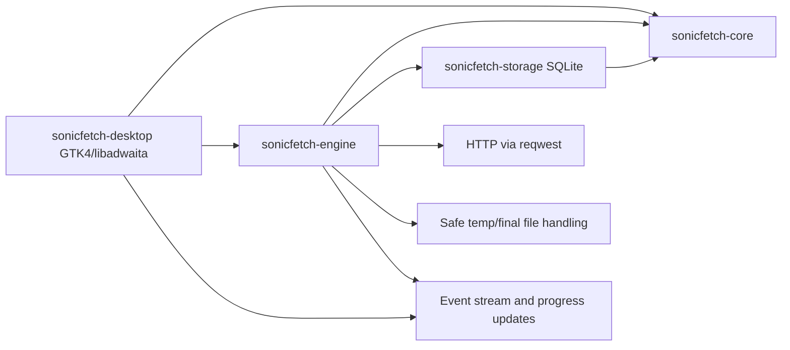
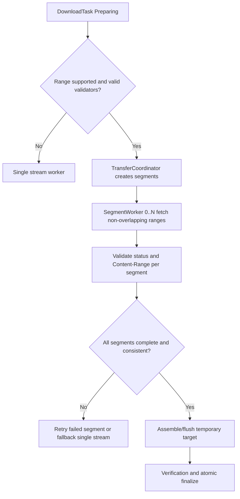

# SonicFetch Architecture

Date: 2026-10-30
Status: Phase B architecture finalization before implementation.

## 1. Scope and Context

Established requirements:
- Native Linux desktop download manager.
- Independent implementation; no proprietary code reuse.
- Core transfer engine decoupled from UI.
- Persistence-backed queue, pause/resume, retries, and segmented transfers.
- Security-first defaults and deterministic testing.

Observed workspace reality:
- SonicFetch currently contains architecture/research documents only.
- No pre-existing Rust implementation is available to adapt.

## 2. Selected Technology Stack

Selected baseline:
- Language: Rust (edition 2024)
- UI: GTK4 + libadwaita
- Async runtime: Tokio 1.48
- HTTP: reqwest 0.12
- Persistence: SQLite via sqlx 0.8 (runtime tokio-rustls + sqlite)
- Serialization: serde 1.0 + serde_json 1.0
- Logging/diagnostics: tracing 0.1 + tracing-subscriber 0.3
- URL validation: url 2.x
- Checksums: sha2 0.10
- Temporary files: tempfile 3.x
- Error modeling: thiserror 2.x
- Cancellation primitives: tokio-util 0.7 (CancellationToken)

Decision note:
- Versions above are selected targets for initial implementation and will be locked in Cargo.toml/Cargo.lock during Phase C and beyond.

## 3. Architecture Principles

Established requirements:
- Engine must be testable headless.
- No backend server; local desktop app only.
- Explicit state machine and persistence-backed recovery.

Implementation proposal:
- Four-crate Cargo workspace:
  - sonicfetch-core: domain types, state machine, errors, policies
  - sonicfetch-engine: transfer orchestration, HTTP I/O, queue/scheduler
  - sonicfetch-storage: SQLite schema, migrations, repositories
  - sonicfetch-desktop: GTK/libadwaita UI, notifications, user actions

Rationale:
- Keeps boundaries clear while avoiding excessive crate fragmentation.

## 4. High-Level Runtime Architecture

## 5. Segmented Transfer Coordination

## 6. Trust Boundaries and Data Flow

Boundary summary:
- Untrusted: remote servers, response headers, payload bytes, user-provided URLs.
- Trusted runtime: local process memory, validated DB metadata, safe filesystem operations.

Data-flow requirements:
- Never merge segment bytes across changed validators.
- Persist resumable metadata before and during long operations.
- Emit structured progress events suitable for both UI and tests.

## 7. Operational Constraints

- No claims of acceleration when server/network cannot benefit.
- Fallback path to single-stream is required and first-class.
- Completion state is only allowed after finalization and optional checksum verification succeed.
