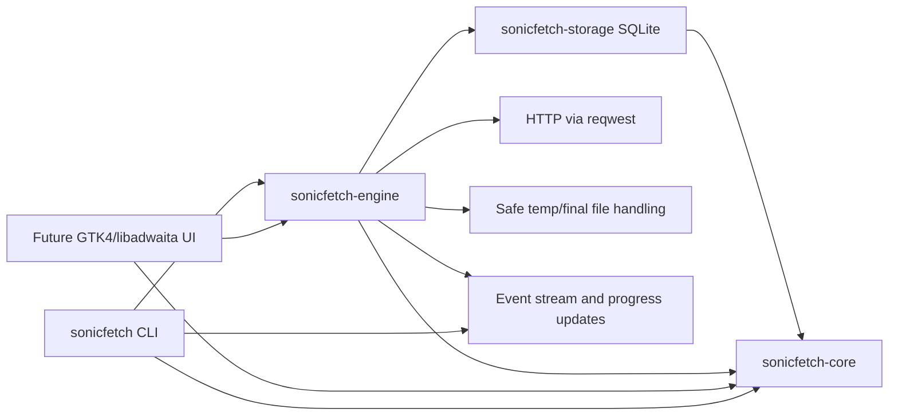
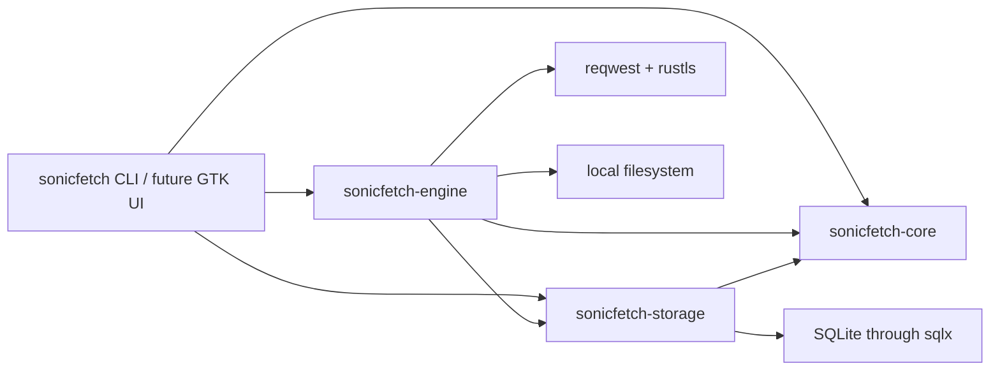
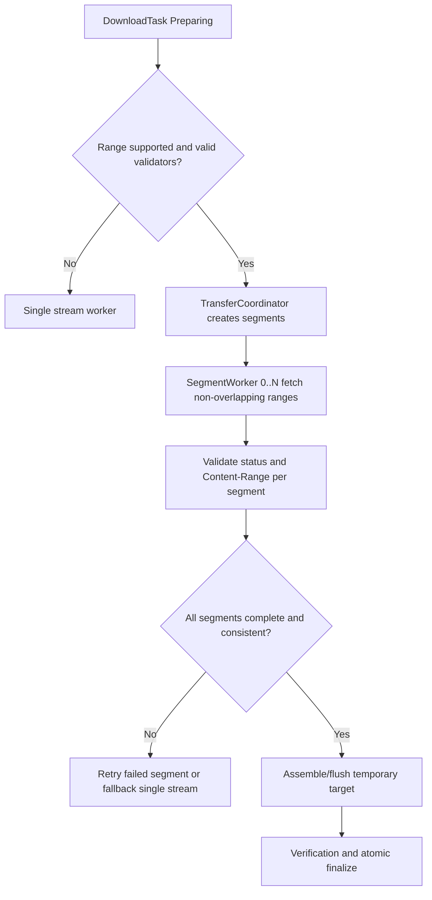

# SonicFetch Architecture

Date: 2026-10-30
Status: Architecture target checked against the current CLI prototype; not build-verified.

## 1. Scope and Context

Established requirements:
- Native Linux desktop download manager.
- Independent implementation; no proprietary code reuse.
- Core transfer engine decoupled from UI.
- Persistence-backed queue, pause/resume, retries, and segmented transfers.
- Security-first defaults and deterministic testing.

Implemented workspace:
- Rust workspace contains core lifecycle types, a SQLite repository, an HTTP/HTTPS transfer engine, and a CLI binary named `sonicfetch`.
- Active downloads use SQLite process leases so a second CLI invocation can pause, cancel, or wait before resuming the same task.
- The graphical GTK4/libadwaita interface, background scheduler, and segmented transfers remain future work.

## 2. Selected Technology Stack

Selected baseline:
- Language: Rust (edition 2024)
- UI: GTK4 + libadwaita
- Async runtime: Tokio 1.x
- HTTP: reqwest 0.12 with rustls and native certificate roots
- Persistence: SQLite via sqlx 0.8 (runtime tokio-rustls + sqlite)
- Serialization: Serde 1.x
- Logging/diagnostics: tracing 0.1 + tracing-subscriber 0.3
- URL validation: url 2.x
- Error modeling: thiserror 2.x
- Cancellation primitives: tokio-util 0.7 (CancellationToken)

Decision note:
- The manifests declare compatible version ranges; Cargo.lock is not present. Exact resolved versions and compilation remain unverified because Cargo is unavailable in this environment.
- `sha2` remains deferred until checksum verification is implemented. `tempfile` is used only as an engine test dev-dependency; production transfers use explicit same-directory temporary paths for restart recovery.

Declared direct dependency baselines (not a lockfile resolution): Rust 1.85; Tokio 1.48.0; reqwest 0.12.24; sqlx 0.8.6; Serde 1.0.228; tracing 0.1.41; tracing-subscriber 0.3.20; url 2.5.7; tokio-util 0.7.16; uuid 1.18.1; chrono 0.4.42; thiserror 2.0.17; anyhow 1.0.100; futures-util 0.3.31; libc 0.2.177. Engine tests use tempfile 3.23.0 as a dev-dependency. GTK4/libadwaita versions are not selected because no UI dependency has been added.

## 3. Architecture Principles

Established requirements:
- Engine must be testable headless.
- No backend server; local desktop app only.
- Explicit state machine and persistence-backed recovery.

Current implementation and target boundaries:
- Four-crate Cargo workspace:
  - sonicfetch-core: domain types, state machine, errors, policies
  - sonicfetch-engine: transfer orchestration, HTTP I/O, queue/scheduler
  - sonicfetch-storage: SQLite schema, migrations, repositories
  - sonicfetch-desktop: CLI entry point today; planned GTK/libadwaita UI and notifications

Rationale:
- Keeps boundaries clear while avoiding excessive crate fragmentation.

## 4. High-Level Runtime Architecture

## 4.1 Component dependency boundaries

## 5. Segmented Transfer Coordination

## 6. Trust Boundaries and Data Flow

Boundary summary:
- Untrusted: remote servers, response headers, payload bytes, user-provided URLs.
- Trusted runtime: local process memory, validated DB metadata, safe filesystem operations.

Data-flow requirements:
- Never merge segment bytes across changed validators.
- Persist resumable metadata before and during long operations.
- Emit structured progress events suitable for both UI and tests.

## 7. Operational Constraints

- No claims of acceleration when server/network cannot benefit.
- Fallback path to single-stream is required and first-class.
- Completion state is only allowed after finalization and optional checksum verification succeed.
- Browser integration and Site Grabber remain opt-in proposals; no browser activity is collected by the current prototype.
