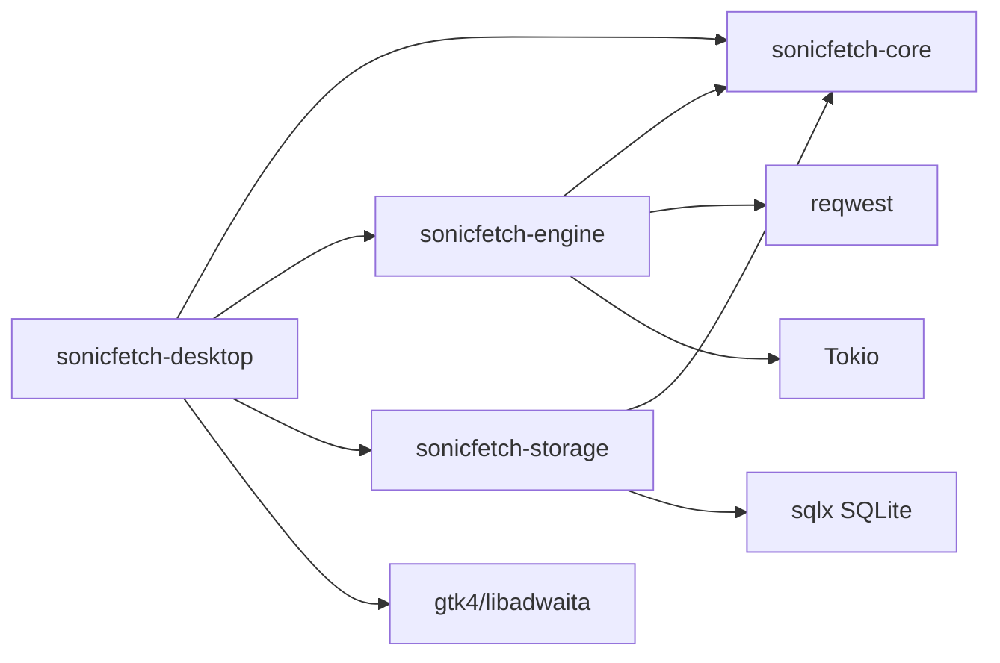

# Component Map

Date: 2026-10-30
Status: Proposed component boundaries based on approved requirements.

## 1. Workspace Components

Planned crates:
- crates/sonicfetch-core
- crates/sonicfetch-engine
- crates/sonicfetch-storage
- crates/sonicfetch-desktop

Supporting directories:
- migrations/
- tests/integration
- tests/fixtures
- tests/security
- packaging/deb
- packaging/flatpak

## 2. Responsibilities

sonicfetch-core:
- Download states and transitions
- Error taxonomy
- Domain DTOs and event contracts
- Retry policy and scheduler policy interfaces

sonicfetch-engine:
- DownloadManager and task orchestration
- TransferCoordinator and SegmentWorker lifecycle
- HTTP request/response handling and fallback logic
- Cooperative cancellation and progress aggregation

sonicfetch-storage:
- SQLite migrations
- Repository interfaces and implementations
- Crash recovery snapshots and history persistence
- Settings/category CRUD

sonicfetch-desktop:
- GTK windows/views/dialogs
- User action dispatch to engine
- Event subscription and rendering
- Notification dispatch

## 3. Dependency Graph

## 4. Internal Engine Subcomponents

Engine module map:
- download_manager
- download_task
- queue_scheduler
- transfer_coordinator
- segment_worker
- integrity_verifier
- progress_aggregator
- file_safety

Cross-cutting services:
- configuration_service
- event_bus
- diagnostics

## 5. External Interface Contracts

Engine-facing API (proposal):
- add_download(request)
- pause(download_id)
- resume(download_id)
- cancel(download_id)
- retry(download_id)
- remove(download_id)
- subscribe_events()
- list_downloads(filter)

Storage-facing API (proposal):
- create_download(record)
- update_download_state(id, state)
- upsert_segments(id, segments)
- append_history(event)
- restore_unfinished_downloads()

UI-facing API (proposal):
- state snapshots + incremental events
- action response errors as typed user-actionable classes
