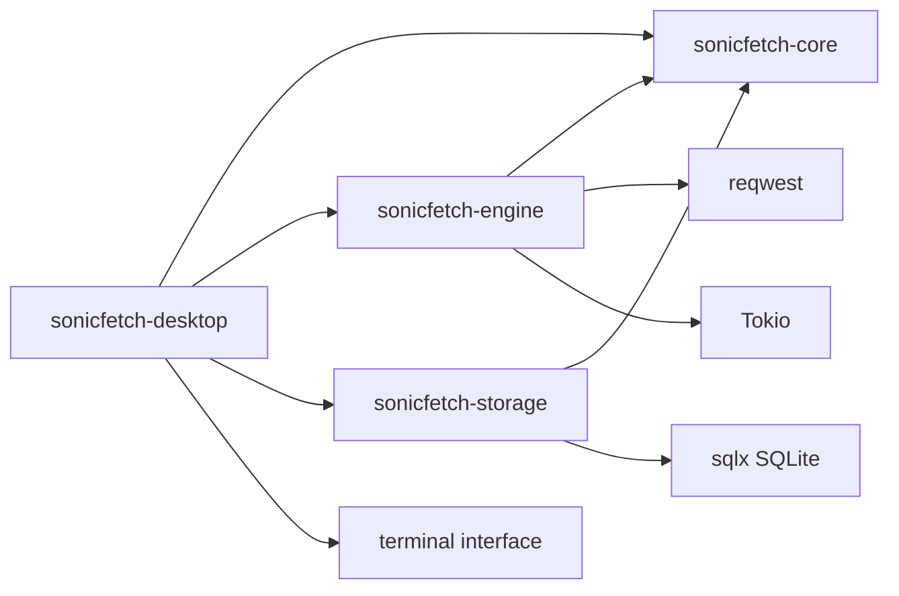

# Component Map

Date: 2026-10-30
Status: Current crate boundaries and planned extensions.

## 1. Workspace Components

Implemented crates:
- crates/sonicfetch-core
- crates/sonicfetch-engine
- crates/sonicfetch-storage
- crates/sonicfetch-desktop

Supporting directories:
- migrations/
- tests/integration
- tests/fixtures
- tests/security
- packaging/deb
- packaging/flatpak

## 2. Responsibilities

sonicfetch-core:
- Implemented: download states, transition validation, typed lifecycle errors
- Planned: retry policy, scheduler contracts, and shared task DTOs

sonicfetch-engine:
- DownloadManager and single-task orchestration
- HTTP request/response handling, validator resume, and cooperative cancellation
- Structured progress events and atomic no-overwrite finalization

sonicfetch-storage:
- SQLite schema initialization and download record persistence
- Worker process leases and interrupted-download recovery
- Progress and state updates
- Planned: categories, settings, segment records, and download history APIs

sonicfetch-desktop:
- CLI command parsing and progress output
- User actions for add/list/pause/resume/retry/cancel/remove
- GTK windows, notifications, and desktop integration remain planned

## 3. Dependency Graph

## 4. Internal Engine Subcomponents

Engine module map:
- Present: `manager.rs` single-stream manager and transfer worker
- Planned: queue scheduler, transfer coordinator, segment workers, integrity verifier, and centralized file-safety module

Cross-cutting services:
- configuration_service
- event_bus
- diagnostics

## 5. External Interface Contracts

Engine API currently implemented:
- add_download(request)
- pause(download_id)
- resume(download_id)
- cancel(download_id)
- retry(download_id)
- remove(download_id)
- subscribe_events()
- list_downloads(filter)

The Rust names are `DownloadManager::{add,pause,resume,cancel,retry,remove,subscribe,list}`. Add accepts a URL and destination path; the manager creates the ID.

Storage API currently implemented:
- create/get/list download rows
- conditionally transition lifecycle state
- update progress and validators
- claim/release worker lease and recover interrupted tasks

Storage APIs still planned:
- upsert_segments(id, segments)
- append_history(event)
- category/settings CRUD

Future UI-facing API:
- state snapshots + incremental events
- action response errors as typed user-actionable classes
