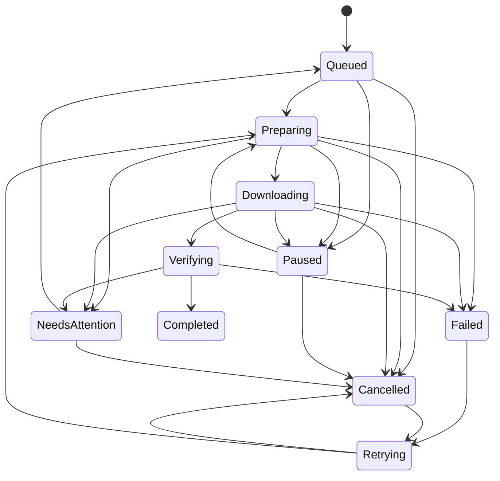
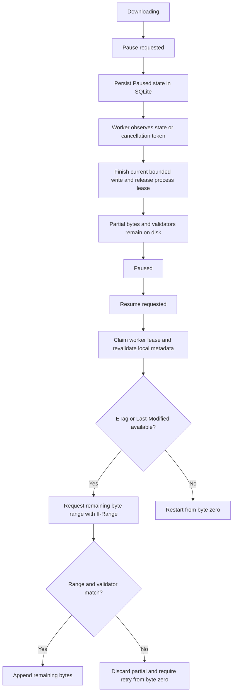
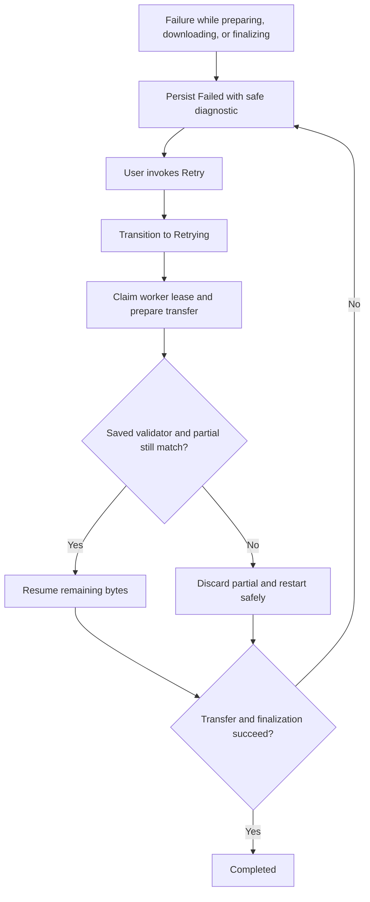
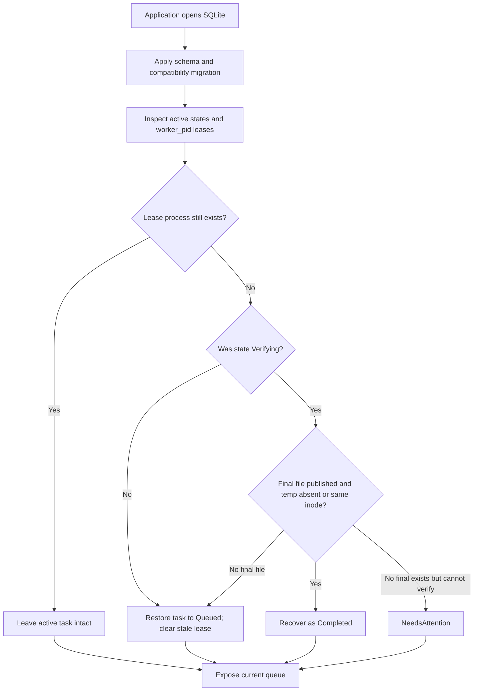

# Download State Machine

Date: 2026-10-30
Status: Canonical lifecycle. Normal SQLite state changes validate through `StateTransition`; startup recovery is the explicit repair exception.

## 1. Canonical States

- Queued
- Preparing
- Downloading
- Paused
- Verifying
- Completed
- Retrying
- Failed
- Cancelled
- NeedsAttention

## 2. Lifecycle Diagram

## 3. Pause/Resume Flow

## 4. Error and Retry Flow

## 5. Transition Rules

Valid target transitions:
- Queued -> Preparing | Paused | Cancelled
- Preparing -> Downloading | Paused | Failed | Cancelled | NeedsAttention
- Downloading -> Paused | Verifying | Failed | Cancelled | NeedsAttention
- Paused -> Preparing | Cancelled | NeedsAttention
- Failed -> Retrying | Cancelled
- Cancelled -> Retrying
- Retrying -> Preparing | Cancelled | Failed
- Verifying -> Completed | Failed | NeedsAttention
- NeedsAttention -> Queued | Cancelled

Invalid transitions examples:
- Completed -> Downloading
- Cancelled -> Downloading
- Queued -> Completed
- Verifying -> Downloading

## 6. Persistence and recovery

Required persisted events:

- State transitions with timestamp and reason.
- Retry attempt number and next-at timestamp.
- Validator changes (ETag/Last-Modified mismatch).
- Segment offsets and bytes written.

Completion guard:
- Mark Completed only after all of:
  - successful stream/segment merge
  - final fsync/rename finalize
  - optional checksum verification (if supplied)

## 7. Cancellation Semantics

- Cancellation is cooperative and token-driven.
- Active workers must stop fetch loops promptly.
- Partial progress must be committed before state change to Paused/Cancelled.

Current implementation note:
- The CLI prototype persists the worker PID and validates normal conditional SQLite state transitions. The worker checks control state while waiting on network reads, stores byte offsets and validators, and releases its lease on normal task completion. Download history and transactional audit entries are still unimplemented.
- Retries are user-triggered; automatic backoff, retry budgets, and persisted retry history are not implemented.

## 8. Required Unit Tests

- Valid transitions accepted.
- Invalid transitions rejected with typed errors.
- Cancellation during Downloading persists partial offsets.
- Retry path honors max attempts and backoff.
- Recovery rebuilds state from persisted metadata.
