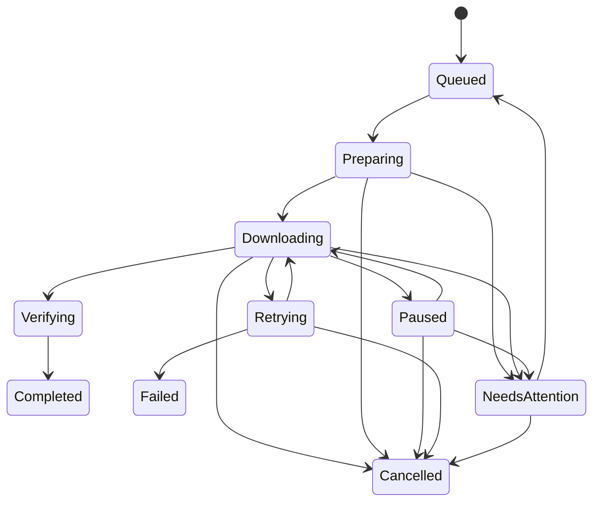
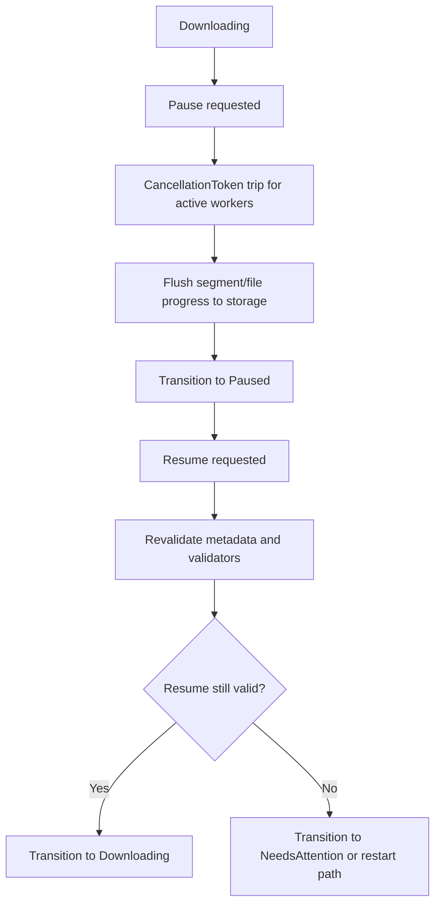
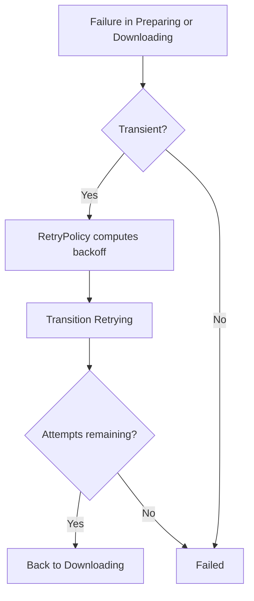

# Download State Machine

Date: 2026-10-30
Status: Required lifecycle definition for SonicFetch engine.

## 1. Canonical States

- Queued
- Preparing
- Downloading
- Paused
- Verifying
- Completed
- Retrying
- Failed
- Cancelled
- NeedsAttention

## 2. Lifecycle Diagram

## 3. Pause/Resume Flow

## 4. Error and Retry Flow

## 5. Transition Rules

Valid transitions (subset):
- Queued -> Preparing
- Preparing -> Downloading | Cancelled | NeedsAttention
- Downloading -> Paused | Verifying | Retrying | Cancelled | NeedsAttention
- Paused -> Downloading | Cancelled | NeedsAttention
- Retrying -> Downloading | Failed | Cancelled
- Verifying -> Completed | Failed | NeedsAttention
- Failed -> Retrying | Cancelled
- NeedsAttention -> Queued | Cancelled

Invalid transitions examples:
- Completed -> Downloading
- Cancelled -> Downloading
- Queued -> Completed
- Verifying -> Downloading

## 6. Persistence Rules

Required persisted events:
- State transitions with timestamp and reason.
- Retry attempt number and next-at timestamp.
- Validator changes (ETag/Last-Modified mismatch).
- Segment offsets and bytes written.

Completion guard:
- Mark Completed only after all of:
  - successful stream/segment merge
  - final fsync/rename finalize
  - optional checksum verification (if supplied)

## 7. Cancellation Semantics

- Cancellation is cooperative and token-driven.
- Active workers must stop fetch loops promptly.
- Partial progress must be committed before state change to Paused/Cancelled.

## 8. Required Unit Tests

- Valid transitions accepted.
- Invalid transitions rejected with typed errors.
- Cancellation during Downloading persists partial offsets.
- Retry path honors max attempts and backoff.
- Recovery rebuilds state from persisted metadata.
