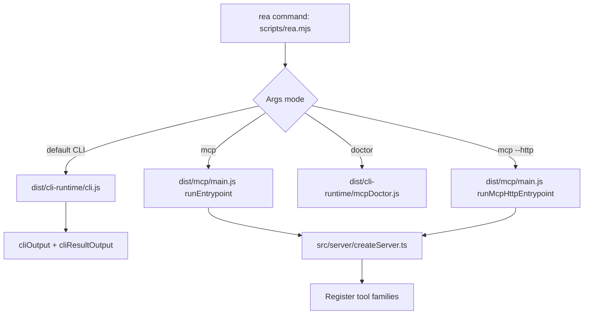
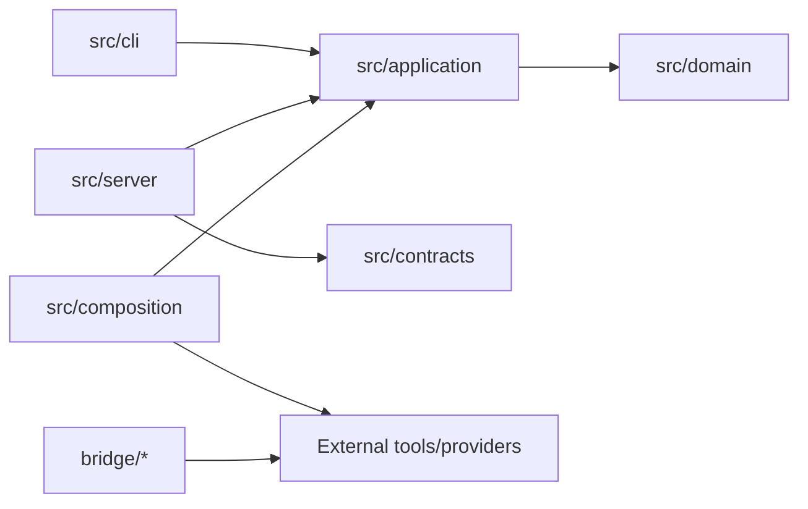
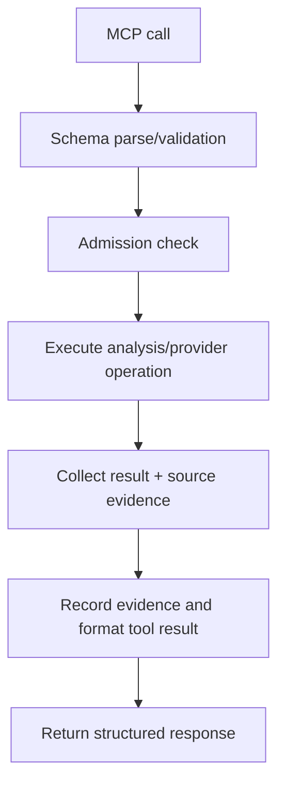
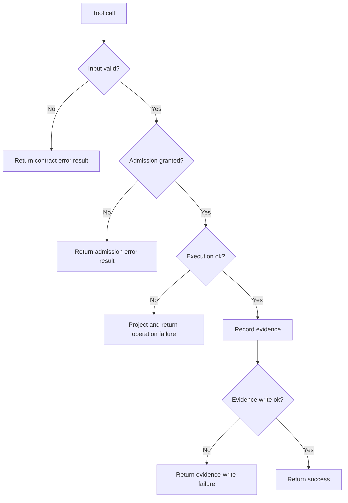

# Repository Architecture Report: morluto/rea

Date: 2026-10-30
Repository analyzed locally at: /home/panda/Desktop/SonicFetch/rea
Version observed: 6.8.0 (tag: rea-agents-6.8.0)
License observed: MIT

## 1) Repository Overview

Verified facts:
- Project identity in README/package metadata: REA (Reverse Engineer Anything), delivered as CLI and MCP server.
- Package name: rea-agents.
- Entrypoint command: rea / rea-agents via scripts/rea.mjs.
- Stated purpose: reverse engineering workflows for binaries, applications, and runtime observation.

Conclusion:
- This repository is not a download manager implementation.
- It is a reverse-engineering tooling platform and MCP server.

## 2) Directory and Module Map

High-level directories (verified):
- src: primary TypeScript source code.
- scripts: CLI dispatch/build/verification automation.
- bridge: integration bridges for external analysis tools (Java, Python, Swift).
- docs: extensive capability and operational documentation.
- tests: acceptance, boundary, process-global, evaluation, support.
- native: native artifacts and platform-specific integration assets.
- website: documentation/site assets.

Key module groupings from src (verified):
- src/main: startup/runtime transport/lifecycle.
- src/server: MCP server creation and tool registration.
- src/cli: command definitions and output handling.
- src/application + src/domain + src/composition: service ports, domain logic, assembly/wiring.
- src/contracts: tool schema/contracts.

## 3) Dependency Snapshot

Verified facts from package metadata:
- Runtime dependencies include MCP client/server packages, Playwright core, pino, asar parsing, protobuf, JSON/schema utilities.
- Dev stack includes vitest, turbo, typescript, stryker, lint/format tools.
- Node engine requirement is modern (22/24/26 tracks).

Strongly supported inference:
- Architecture emphasizes contract-first tool interfaces, multi-provider integration, and verification-heavy CI.

## 4) Execution Flow

Verified facts:
- scripts/rea.mjs dispatches runtime mode based on arguments.
- Modes include MCP stdio, MCP HTTP, doctor, and CLI output paths.
- src/server/createServer.ts aggregates service creation and registration of tool families.
- src/server/registerEvidenceTools.ts wraps provider-backed operations with evidence recording and tool-result formatting.
- src/server/registerInvestigationTools.ts registers derived workflows like call-path and changed-behavior correlation.

### Startup/dispatch diagram

## 5) Core Abstractions and Interfaces

Verified facts:
- EvidenceMcpServer acts as core MCP registration/delivery surface.
- Tool contracts are registered with schemas/options and result adapters.
- withAdmittedAnalysis and runAdmittedToolOperation gate tool execution under session/analysis admission rules.
- App/domain/composition split exists across source tree.

Strongly supported inference:
- Design follows layered architecture:
  - Domain: pure analysis logic and result semantics.
  - Application: service interfaces and use-case orchestration.
  - Composition/Server: concrete wiring to providers and transport.

### Module dependency view (simplified)

## 6) Data Flow and Control Flow

Verified facts:
- Requests reach server tool handlers via MCP transport.
- Handlers validate input, run admitted operations, and produce structured results.
- Evidence recording and progress signaling are integrated in registerEvidenceTools.

### Tool invocation lifecycle

### Error and recovery flow

## 7) Build and Packaging Workflow

Verified facts:
- Build/check/test orchestration is script-heavy via npm scripts and turbo.
- Extensive verification commands exist for providers/features.
- Package includes dist runtime, bridges, scripts, plugin metadata.

Strongly supported inference:
- Packaging emphasizes reproducible validated artifacts and provider sanity checks.

## 8) Testing Strategy

Verified facts:
- Vitest projects for boundary/acceptance/integration/process scopes.
- Python unit tests for some bridge components.
- Mutation testing configured via Stryker.
- Numerous verify scripts for real-tool integrations.

Strongly supported inference:
- Testing approach is multi-layered: unit + integration + tool-conformance + packaging verification.

## 9) Security Model (Repository Itself)

Verified facts:
- README warns users to install from official sources.
- Runtime has process and output guardrails in entry script.
- Evidence-centric design tends to expose limits/unknowns explicitly in outputs.

Strongly supported inference:
- Security posture focuses on controlled analysis execution, explicit tool contracts, and defensive operational checks.

## 10) License and Reuse Assessment

Verified facts:
- LICENSE is MIT.

Legal suitability for reuse:
- MIT permits reuse/modification/distribution with notice retention.
- Reuse must still respect third-party dependency licenses and included notices.

For the Linux download-manager project:
- Suitable reuse category: architectural patterns (layering, contracts, structured errors, verification discipline).
- Not directly reusable as download engine code because repository scope is reverse engineering, not transfer management.

## 11) Limitations and Missing Features Relative to Target Project

Verified gap:
- No native download-manager engine modules were identified.
- No direct queue/scheduler/segment-transfer modules for HTTP downloads as a product focus.

Implication:
- We should not force-fit this repository as a base download manager.
- Use it as an architectural inspiration source, not as functional download-engine source.

## 12) Components Informative for Independent Implementation

Potentially informative patterns:
- Contract-first interfaces for tool boundaries.
- Explicit admission/validation before operation execution.
- Structured result objects and error projection.
- Evidence and limitation reporting discipline.
- Rich verification/test matrix style.

## 13) Confidence and Evidence Labels

This report uses:
- Verified fact
- Strongly supported inference
- Unverified hypothesis
- Not observable from available evidence

No claim is made that REA is functionally equivalent to IDM or any download manager.
